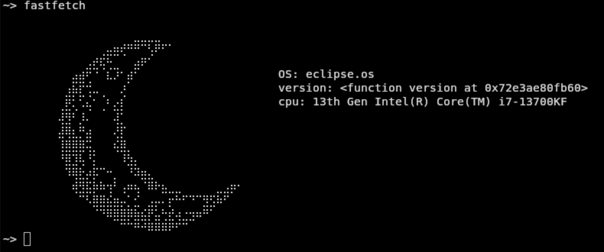
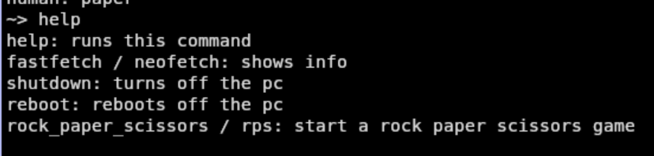
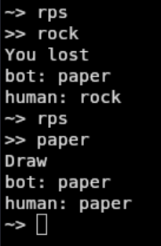

a terminal emulator that works in terminal, flying cars they said...

## Installation

EclipseOS is available on [PyPI](https://pypi.org/project/eclipseos/).

    pip install eclipseos

Or with uv:

    uv tool install eclipseos

Then run it with:

    eclipseos

## Description

It is a terminal coded in pycharm that you want to mainly run in your terminal because that way the ui is gonna look the best.

Also right now it only work on linux (yes I will make settings so you can set it to windows and it is gonna work just fine)

there is really not much to say about it because it is a very early version

## Screenshots of the eclipseOS

